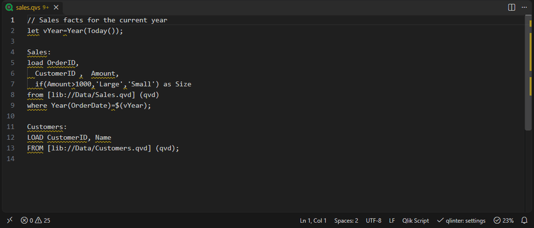
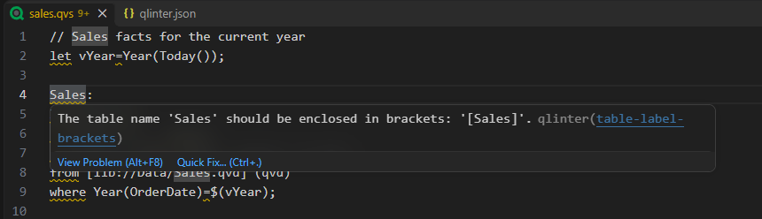
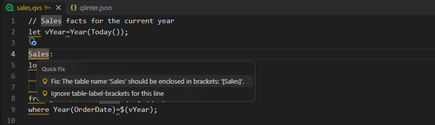
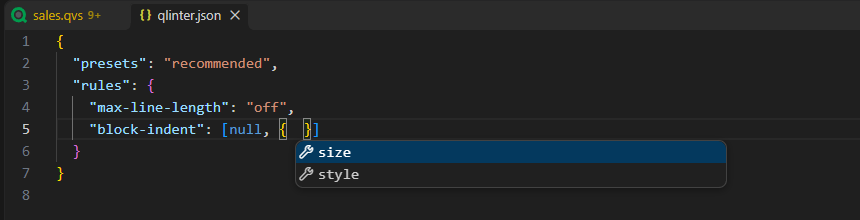

<p align="center">
  
  <h1 align="center">qlinter-vscode-ext</h1>
</p>
<p align="center">
  VS Code extension for qlinter — brings inline linting and one-click formatting for Qlik load scripts into the editor.
</p>
<p align="center">
  
  
  
</p>

<table align="center">
  <tr><td align="center"></td></tr>
  <tr><td align="center"><b>Demo:</b> Extension in action</td></tr>
</table>

<br />

Everyone on your team writes Qlik script their own way? qlinter checks every `.qvs` file against
one opinionated style guide, shows what is off right where you write, and fixes most of it for
you.

## Features

**Findings inline.** Style issues are underlined as you type and listed in the Problems panel.
Hover one to see what is wrong, with a link to the rule's reference.



**Fix or ignore in one click.** The lightbulb fixes a single finding, or adds
`// qlinter-disable-next-line <rule>` above the line when you mean to keep it.



**Format the whole script.** _Format Document_ (`Shift+Alt+F`) or **qlinter: Fix all auto-fixable
problems** applies every fix at once — on save too, if you like.

**Conformance score.** The status bar shows how many lines of the open script are free of
findings, as a percentage.

**Team config with autocompletion.** Put a `qlinter.json` in your project and VS Code completes
rule names, severities and options, and flags anything qlinter would reject.



**Private by design.** Everything runs locally; your scripts never leave your machine. The
interface is available in English and German.

## Getting started

1. Install the extension.
2. Open a `.qvs` file. It is checked right away with the `recommended` preset — no setup needed.

qlinter checks and formats your scripts but does not color them. For syntax highlighting, add an
extension that provides the `qlik` language, such as
[Assorted Languages](https://marketplace.visualstudio.com/items?itemName=EdwinKofler.vscode-assorted-languages).

To format on every save, add this to your `settings.json`:

```jsonc
"[qlik]": {
  "editor.formatOnSave": true
}
```

## Configuration

To adjust rules, run **qlinter: Create qlinter.json** from the Command Palette. It creates a
`qlinter.json` in your workspace folder, the same file the
[qlinter CLI](https://github.com/MuellerConstantin/qlinter/tree/main/packages/cli) reads:

```json
{
  "presets": "recommended",
  "rules": {
    "max-line-length": "off",
    "block-indent": [null, { "size": 4 }]
  }
}
```

When a `qlinter.json` is present, it is used for every script in that folder. Without one — for
example for a single `.qvs` file opened on its own — the `qlinter.presets` setting applies. The
status bar shows which one is in effect. All rules and their options are described in the
[rule reference](https://github.com/MuellerConstantin/qlinter/blob/main/packages/core/docs/rules.md).

| Command                                  | What it does                                      |
| ---------------------------------------- | ------------------------------------------------- |
| `qlinter: Fix all auto-fixable problems` | Applies every available fix to the open script    |
| `qlinter: Create qlinter.json`           | Creates a `qlinter.json`, or opens the one there  |
| `qlinter: Show active configuration`     | Opens the `qlinter.json` or settings in effect    |

| Setting           | Default           | What it does                                          |
| ----------------- | ----------------- | ----------------------------------------------------- |
| `qlinter.presets` | `["recommended"]` | Presets to lint with when there is no `qlinter.json`  |

## Privacy

qlinter collects nothing and makes no network requests. Details are in the
[privacy policy](https://github.com/MuellerConstantin/qlinter/blob/main/docs/PRIVACY.md).
